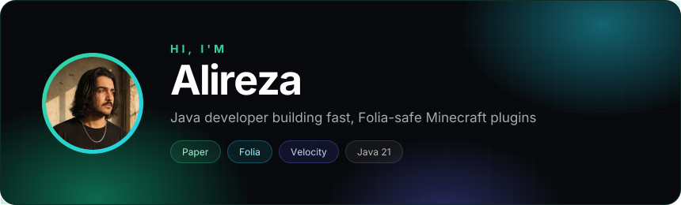
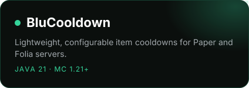
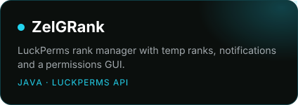
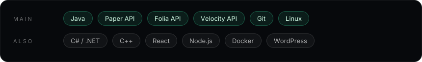

 

I started learning Java to build custom plugins for my own server, [Asia.noxel.fun](https://asia.noxel.fun), and it grew into a focus on multithreaded, Folia-safe server software. I also work with C# and .NET.

* 🌍 Based in Iran · open to work
* 🛠️ Building **NoxelLib**, a shared library for NoxelSMP
* 🧠 Learning PacketEvents and Folia's region-threaded scheduling

## Featured

## Folia Ports

Porting established plugins to Folia's multithreaded server:

| Project | What it is |
|---|---|
| [**Folia-AuraSkills-Update**](https://github.com/Xenos-core/Folia-AuraSkills-Update) | RPG skills plugin, maintained with Folia support |
| [**Folia-lagfixer**](https://github.com/Xenos-core/Folia-lagfixer) | Server performance optimizer |
| [**SvcAdminSpyFolia**](https://github.com/Xenos-core/SvcAdminSpyFolia) | Simple Voice Chat moderation add-on |
| [**lastwordsFolia**](https://github.com/Xenos-core/lastwordsFolia) | Folia-compatible fork |
| [**LimboAPI**](https://github.com/Xenos-core/LimboAPI) | Virtual-server API for Velocity-CTD proxies |

## Stack

