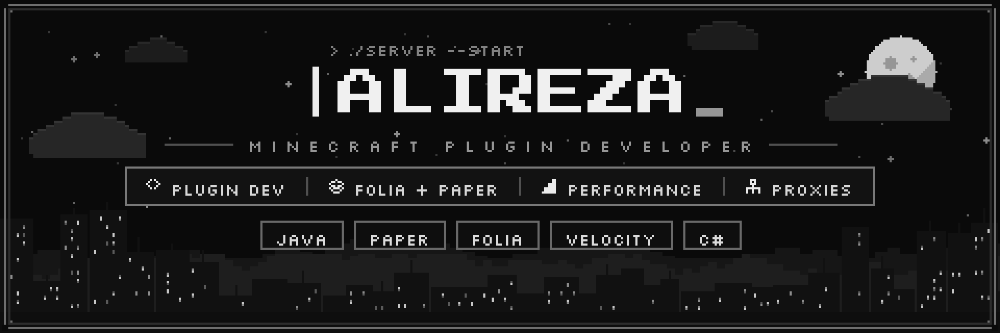
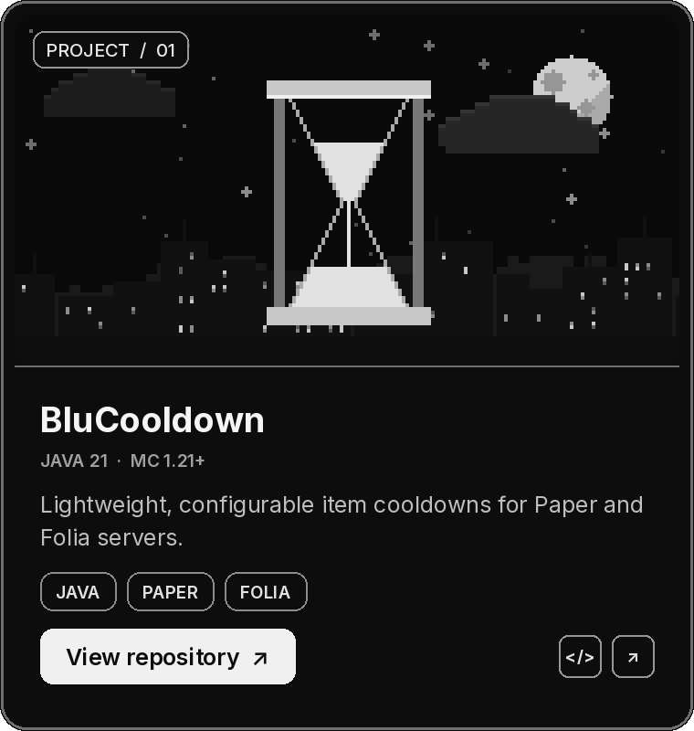
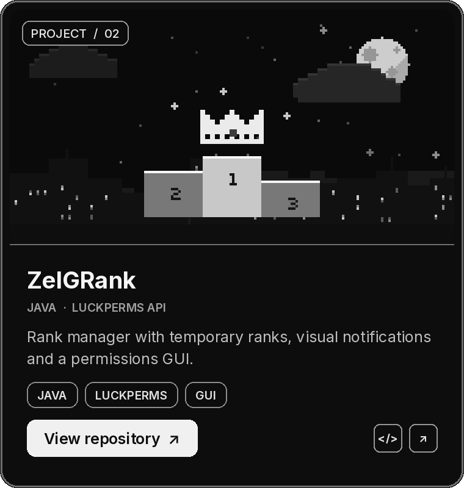

  

  
  
  

  
  
  
  

---

## ✦ About Me

I'm **Alireza**, a Java developer from Iran building **high-performance Minecraft server plugins** for Paper and Folia.

I started learning Java to build custom plugins for my own server, [**Noxel SMP**](https://asia.noxel.fun), and it grew into a focus on multithreaded, Folia-safe server software. I also work with C# / .NET.

## ⌘ Tech Stack

**Core:** `Java` · `Paper API` · `Folia API` · `Velocity API`  
**Also:** `C#` · `.NET` · `C++` · `React` · `Node.js`  
**Tools:** `Git` · `Linux` · `Docker` · `IntelliJ IDEA` · `VS Code`

  
  
  
  
  
  

## ▣ Featured Projects

  
  

<strong>✦ BluCooldown — features & highlights</strong>

Lightweight, configurable item cooldowns for Paper and Folia servers.

- Per-item cooldowns set in config
- Runs on Paper and Folia
- Built for Java 21 and Minecraft 1.21+

[View repository](https://github.com/Xenos-core/BluCooldown)

<strong>✦ ZelGRank — features & highlights</strong>

A LuckPerms rank manager.

- Temporary ranks
- Visual rank notifications
- Permissions GUI

[View repository](https://github.com/Xenos-core/ZelGRank)

## ⚙ Folia Ports & Contributions

| Project | What it is |
|---|---|
| [**Folia-AuraSkills-Update**](https://github.com/Xenos-core/Folia-AuraSkills-Update) | RPG skills plugin, maintained with Folia support |
| [**Folia-lagfixer**](https://github.com/Xenos-core/Folia-lagfixer) | Server performance optimizer |
| [**SvcAdminSpyFolia**](https://github.com/Xenos-core/SvcAdminSpyFolia) | Simple Voice Chat moderation add-on |
| [**lastwordsFolia**](https://github.com/Xenos-core/lastwordsFolia) | Folia-compatible fork |
| [**LimboAPI**](https://github.com/Xenos-core/LimboAPI) | Virtual-server API for Velocity-CTD proxies |

## ☾ Currently

- Building **NoxelLib**, a shared library for Noxel SMP
- Learning PacketEvents and Folia's region-threaded scheduling

## ▤ GitHub Activity

  

---

  <strong>✦ Build · Port · Optimize ✦</strong> 
  Thanks for stopping by.

